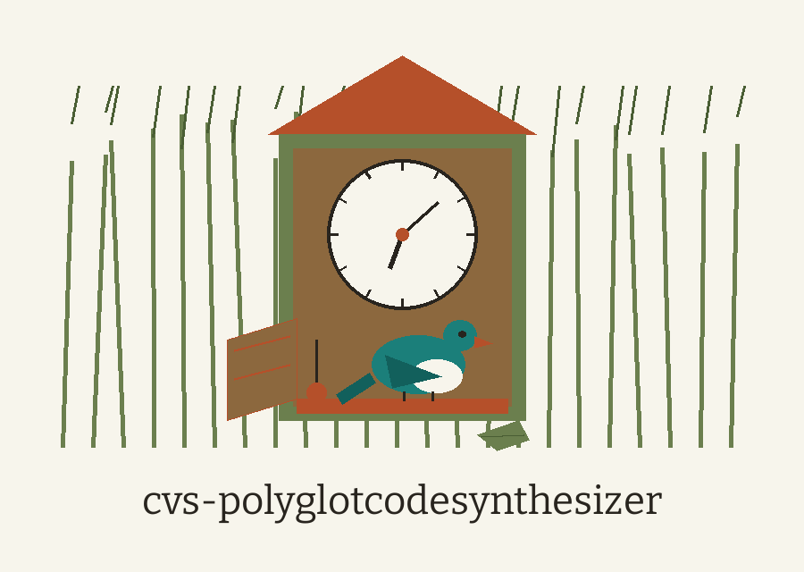
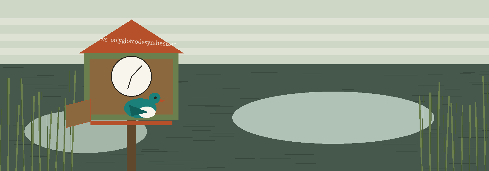

# cvs-polyglotcodesynthesizer

Title block: the name above is set in Boogaloo in kingfisher teal on a river white plate, with a rust rule beneath it and one small cuckoo on a clock door at the left of the first heading only, in the manner of a field guide plate.

# cvs-PolyglotCodeSynthesizer
Generates a short intentionally vulnerable snippet for one chosen pattern (xss, sql_injection or command_injection) from fixed templates with a random string filling part of the length, and writes it to a file. The --languages argument is accepted and required, but the templates are plain text and the languages do not change the generated snippet; no language specific parsing is performed. - Focused on Tools designed to automatically generate vulnerable code snippets based on common vulnerability patterns (e.g., SQL injection, XSS, command injection). This facilitates training and testing of security scanners and code analysis tools, as well as enabling developers to understand and avoid specific vulnerabilities.

## Install
`git clone https://github.com/ShadowGuard-AI/cvs-polyglotcodesynthesizer`

> Day book note: the output is intentionally vulnerable, stated plainly. One short snippet is written to a file, and no snippet text is printed in this README.

## Usage
`python3 main.py --vulnerability VULN --languages LANG [LANG ...]`

> Day book note: the languages flag changes nothing. It must be given, its values pass a placeholder check that returns true for every value, and no later step reads them.

## Parameters
- `-h`: Show help message and exit
- `--vulnerability`: The type of vulnerability to introduce: `xss`, `sql_injection`, or `command_injection` (required).
- `--languages`: The target languages/interpreters for the polyglot snippet (required, one or more).
- `--length`: The approximate length of the generated code snippet (default: 20).
- `--output_file`: The file to write the generated code snippet to. If not specified, a random filename is generated in the output directory.
- `--offensive`: Generate snippet suitable for direct execution (more 'offensive'). Requires extra caution.

> Day book note: length is approximate, and one form ignores it. The scripting forms size their filler at half the length, the injection forms at a quarter, one offensive command form fixes its filler at five characters, and the offensive SQL form stays fixed whatever was asked.

## License
Licensed under the terms in LICENSE.

## Day book notes, gathered at the fen

The buttons of this re-skin read Make the Snippet, Use the Plain Form, Use the Offensive Form, and Show the Day Book. Its headings read One Snippet, Written to a File, Three Template Classes Only, Languages Change Nothing, and Length Is Approximate. Two facts are entered once more at full size: a run makes a single language example for its class and does not make a true polyglot across the named languages, and the repository LICENSE file carries the MIT License, its holder line giving a pen name together with a single initial for the remaining name.
